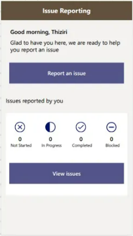
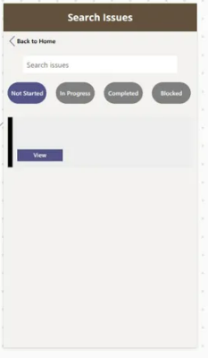
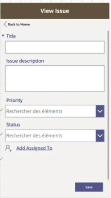
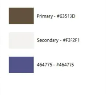

# Issue Tracker (Power Apps)

A Power Apps canvas app for reporting and tracking issues, backed by a SharePoint list.

Based on Microsoft's **Issue Reporting** Power Apps template, modified by **Thiziri Arour**.

## Screenshots

| Home | Search Issues | Report / Edit Issue |
|:---:|:---:|:---:|
|  |  |  |
| Greeting and the count of your issues by status | Filter by status and search by title | Title, description, priority, status and assignee |

**Colour palette** (Branding screen)

## Contents

- `Issue_Tracker.msapp` – the packaged app, ready to import into Power Apps Studio
- `Issue Tracker/` – unpacked source of the app (screens, formulas, data sources)
- `screenshots/` – screenshots used in this README

